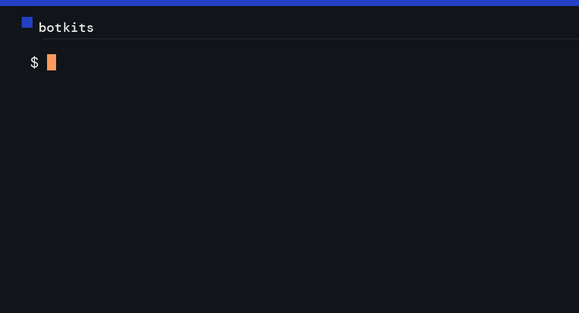
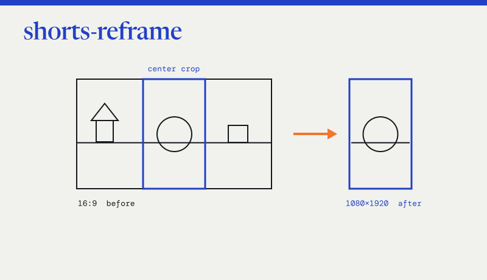
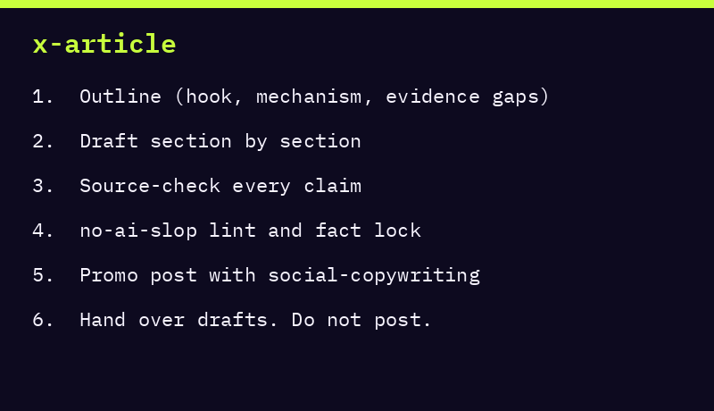
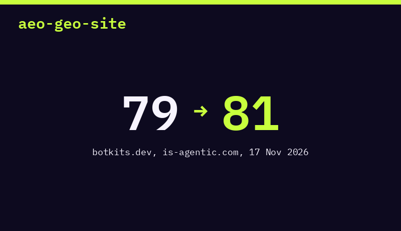
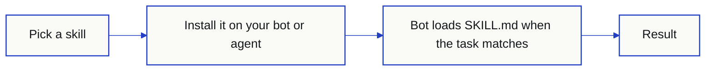

<p align="center">
  <picture>
    <source media="(prefers-color-scheme: dark)" srcset="assets/header-dark.png 1x, assets/header-dark@2x.png 2x">
    <source media="(prefers-color-scheme: light)" srcset="assets/logo-wide.png 1x, assets/logo-wide@2x.png 2x">
    
  </picture>
</p>

<p align="center">
  <a href="LICENSE"></a>
  <a href="https://github.com/botkitsdev/botkits/stargazers"></a>
  <a href="#all-skills"></a>
  <a href="https://botkits.dev"></a>
</p>

# Skills your bots can run today

Open SKILL.md folders for Claude, ChatGPT, Codex, Cursor, Gemini, Copilot and Grok Bot. 32 skills, used daily by my own Grok Bots. MIT.

<p align="center">
  <a href="https://botkits.dev">Browse on botkits.dev</a>
  &nbsp;·&nbsp;
  <a href="https://botkits.dev/kits/">Paid kits</a>
  <!-- Free Starter Pack: hidden until the pack is live. -->
</p>

Kits and install guides: [botkits.dev](https://botkits.dev)

<p align="center">
  
</p>

[Top 3](#top-3) · [Quick start](#quick-start) · [Start here](#start-here) · [All 32 skills](#all-skills) · [Renamed skills](#renamed-skills) · [How a skill is used](#how-a-skill-is-used) · [Tool requirements](#tool-requirements) · [Contribute](#contribute) · [Inspired by](#inspired-by) · [License](#license)

## Top 3

<table>
<tr>
<td valign="top" width="33%">
<p align="center"><a href="skills/video/botkits-shorts-reframe/"></a></p>
<strong><a href="skills/video/botkits-shorts-reframe/">botkits-shorts-reframe</a></strong><br>
Turn a 16:9 video into a 1080×1920 Short. Center crop, audio kept, length and size checked.
</td>
<td valign="top" width="33%">
<p align="center"><a href="skills/writing/botkits-x-article/"></a></p>
<strong><a href="skills/writing/botkits-x-article/">botkits-x-article</a></strong><br>
Turn rough notes into an X Article, with a first-line hook, images between sections and no invented numbers.
</td>
<td valign="top" width="33%">
<p align="center"><a href="skills/seo/botkits-aeo-geo-site/"></a></p>
<strong><a href="skills/seo/botkits-aeo-geo-site/">botkits-aeo-geo-site</a></strong><br>
Make your site easy for ChatGPT, Gemini and Copilot to read, understand and cite.
</td>
</tr>
</table>

**Paid kits:** [Shorts Builder Kit, $14](https://botkits.dev/kits/#shorts-builder-kit) · [X Article Writer, $7](https://botkits.dev/kits/#x-article-writer) · [AEO/GEO Site Audit & Build Kit, $9](https://botkits.dev/kits/#aeo-geo-site-audit-build-kit) · [AEO Kit (Markdown Twins + YouTube Watch Pages), $24](https://botkits.dev/kits/#aeo-kit)

<details>
<summary><strong>Paid kit details</strong></summary>

| Kit (result name) | What it is | Price | Link | Free skill |
| --- | --- | --- | --- | --- |
| Audit your site for AI answers, then fix it | AEO/GEO Site Audit & Build Kit | $9 | [Get the kit →](https://daniacostaai.gumroad.com/l/cxabi) | [botkits-aeo-geo-site](skills/seo/botkits-aeo-geo-site/) |
| Make your pages and videos readable by AI answers | AEO Kit (Markdown Twins + YouTube Watch Pages) | $24 | [Get the kit →](https://daniacostaai.gumroad.com/l/wzalwo) | [botkits-markdown-twin](skills/seo/botkits-markdown-twin/) |
| Turn one video into Shorts, QA included | Shorts Builder Kit | $14 | [Get the kit →](https://daniacostaai.gumroad.com/l/ommvol) | [botkits-shorts-reframe](skills/video/botkits-shorts-reframe/) |
| Turn rough notes into an X Article | X Article Writer | $7 | [Get the kit →](https://daniacostaai.gumroad.com/l/lzowtl) | [botkits-x-article](skills/writing/botkits-x-article/) |

</details>

## Quick start

Install the local skills with the [Skills CLI](https://github.com/vercel-labs/skills):

```sh
npx skills add botkitsdev/botkits
```

To install one skill, add `--skill` and its folder name, for example `npx skills add botkitsdev/botkits --skill botkits-no-ai-slop`. Run `npx skills add botkitsdev/botkits --list` to see them all.

For all 32 skills, download the [ZIP](https://github.com/botkitsdev/botkits/archive/refs/heads/main.zip), or clone the repo:

```sh
git clone https://github.com/botkitsdev/botkits.git
```

1. Open a skill from the list below. Read its instructions and tool needs.
2. Copy that skill's folder into the workflows or skills directory your bot uses. Keep its folder name and `SKILL.md` file together. Preserve source credits and applicable license notices.
3. Invoke the folder name with `/` or `@` if your bot supports it. For example, use `/botkits-no-ai-slop`.

The install path and invocation syntax depend on your bot. To try a writing skill without installing it, paste its instructions into a chat, then add your task.

Free skills I use daily to run my 3 YouTube channels. My bots run on Grok Bot. The skills are plain SKILL.md files for any agent that supports the Agent Skills format. Nothing posts or spends without my tap. The paid kits are the tested, ready-to-run versions.

Made by Dani Acosta. Follow on X: [@DaniAcostaAI](https://x.com/DaniAcostaAI)

32 skills for writing, design, code, SEO, ads, YouTube research, video, images, and bot routines. Give your bot a clear process for the job you need done.

Every skill is Dani's own version, inspired by several public references rather than copied from one. Each is a single readable `SKILL.md`. The rewritten skills end with what inspired them, what those references were missing, and what this version adds.

## Start here

| I want to… | Start with |
| --- | --- |
| Remove AI filler from a draft | [botkits-no-ai-slop](skills/writing/botkits-no-ai-slop/) |
| Improve a website's design | [botkits-redesign-existing-projects](skills/design/botkits-redesign-existing-projects/) |
| Create a bot with one clear job | [botkits-design-a-grok-bot](skills/bots/botkits-design-a-grok-bot/) |
| Find noisy or wasteful routines | [botkits-routine-healthcheck](skills/bots/botkits-routine-healthcheck/) |
| Write a post for X or LinkedIn | [botkits-social-copywriting](skills/writing/botkits-social-copywriting/) |
| Write a storytelling hook | [botkits-storytelling-hooks](skills/writing/botkits-storytelling-hooks/) |
| Get better leads from automated ad campaigns | [botkits-whetstone-signal](skills/ads/botkits-whetstone-signal/) |
| Find what wins in a YouTube niche before planning videos | [botkits-youtube-niche-report](skills/youtube/botkits-youtube-niche-report/) |

### Prefer the originals?

These skills credit the work that inspired them. If you want an original instead, install it from its author, for example:

```sh
npx skills add petergyang/no-ai-slop
npx skills add Leonxlnx/taste-skill --skill design-taste-frontend redesign-existing-projects
npx skills add https://github.com/cursor/plugins/tree/main/pstack/skills/make-bot-ui --skill "Make Bot UI"
```

The CLI installs skills for agents such as Claude Code, Codex, Cursor, Gemini CLI, GitHub Copilot and Grok Build. Grok Bot, the ChatGPT app, ChatGPT dots and Meta Muse are not on its agent list. For those, see [Use a skill in other bots](AGENTS.md#use-a-skill-in-other-bots). Tool access still depends on the bot environment.

### Try it

After you load `botkits-no-ai-slop`:

```text
Edit this paragraph. Keep the meaning and my voice. Remove filler.

Our innovative platform leverages cutting-edge technology to seamlessly
empower teams to unlock their full potential.
```

After you load `botkits-redesign-existing-projects`:

```text
Review this landing page. Find the three biggest design problems.
Explain each fix before changing the code. Keep the current features.
```

After you load `botkits-routine-healthcheck`:

```text
Audit my scheduled routines. Find empty runs, duplicate work, and noisy
updates. Show the evidence. Propose changes before applying them.
```

## All skills

<details>
<summary><strong>Writing (10)</strong></summary>

| Skill | What it does |
| --- | --- |
| [botkits-coach](skills/writing/botkits-coach/) | Review a draft's argument and structure before line edits. |
| [botkits-outline](skills/writing/botkits-outline/) | Turn notes or an idea into an article plan. |
| [botkits-draft](skills/writing/botkits-draft/) | Write an article one section at a time. |
| [botkits-source-check](skills/writing/botkits-source-check/) | Check factual claims against named sources. |
| [botkits-no-ai-slop](skills/writing/botkits-no-ai-slop/) | Remove AI writing patterns while keeping the writer's voice. |
| [botkits-top-edit](skills/writing/botkits-top-edit/) | Flag style issues in a final editorial pass. |
| [botkits-social-copywriting](skills/writing/botkits-social-copywriting/) | Write or adapt posts for X and LinkedIn. |
| [botkits-storytelling-hooks](skills/writing/botkits-storytelling-hooks/) | Write a hook by story family, from a fact you already have. |
| [botkits-x-article](skills/writing/botkits-x-article/) | Write long-form X Articles with section images. |
| [botkits-ship-post](skills/writing/botkits-ship-post/) | Turn commits and PRs into one build-in-public post. |

</details>

<details>
<summary><strong>Design (4)</strong></summary>

| Skill | What it does |
| --- | --- |
| [botkits-design-taste-frontend](skills/design/botkits-design-taste-frontend/) | Build landing pages and portfolios from a clear design brief. |
| [botkits-redesign-existing-projects](skills/design/botkits-redesign-existing-projects/) | Audit and improve an existing site's design. |
| [botkits-diagram-design](skills/design/botkits-diagram-design/) | Create explainer diagrams that are branded, not dashboard slop. |
| [botkits-motion-picker](skills/design/botkits-motion-picker/) | Pick one animation library for a single motion moment, with its license and a calm, snappy, or playful preset. |

</details>

<details>
<summary><strong>Engineering (2)</strong></summary>

| Skill | What it does |
| --- | --- |
| [botkits-engineering-playbook](skills/engineering/botkits-engineering-playbook/) | Delegate coding work to cloud agents and review the results. |
| [botkits-show-me](skills/engineering/botkits-show-me/) | Explain code changes with visual PR descriptions. |

</details>

<details>
<summary><strong>SEO (5)</strong></summary>

| Skill | What it does |
| --- | --- |
| [botkits-aeo-geo-site](skills/seo/botkits-aeo-geo-site/) | Structure site content for search and AI-assisted discovery. |
| [botkits-exact-match-intent-seo](skills/seo/botkits-exact-match-intent-seo/) | Match domains, page titles, and URLs to search intent. |
| [botkits-ai-search-gap-loop](skills/seo/botkits-ai-search-gap-loop/) | Track buyer prompts in Google and AI answers, diagnose each loss, make one change, and log the result. |
| [botkits-ai-citation-sources](skills/seo/botkits-ai-citation-sources/) | List the third-party sources AI answers cite and draft one action per source. |
| [botkits-markdown-twin](skills/seo/botkits-markdown-twin/) | Publish a clean markdown copy of one HTML page, advertise it with a link tag, and list it in /llms.txt. |

</details>

<details>
<summary><strong>Ads (1)</strong></summary>

| Skill | What it does |
| --- | --- |
| [botkits-whetstone-signal](skills/ads/botkits-whetstone-signal/) | Pick, score, and send back the conversion event automated ad campaigns optimize for. |

</details>

<details>
<summary><strong>YouTube (1)</strong></summary>

| Skill | What it does |
| --- | --- |
| [botkits-youtube-niche-report](skills/youtube/botkits-youtube-niche-report/) | Pull a niche's top videos, score them against their own channel, and build an interactive HTML report of what wins. Ships with an example config for a made-up niche. |

</details>

<details>
<summary><strong>Video (2)</strong></summary>

| Skill | What it does |
| --- | --- |
| [botkits-shorts-reframe](skills/video/botkits-shorts-reframe/) | Crop a 16:9 video to 9:16, scale it to 1080x1920, keep the audio, and check duration and resolution. |
| [botkits-video-plan-page](skills/video/botkits-video-plan-page/) | Turn a video script into one HTML page with a playable animatic, the shot list, and choices to approve before rendering. Ships with a made-up demo film. |

</details>

<details>
<summary><strong>Bots (6)</strong></summary>

| Skill | What it does |
| --- | --- |
| [botkits-design-a-grok-bot](skills/bots/botkits-design-a-grok-bot/) | Define a bot's job, voice, and wake conditions. |
| [botkits-make-bot-ui](skills/bots/botkits-make-bot-ui/) | Build a custom UI that calls a bot through a webhook. |
| [botkits-routine-healthcheck](skills/bots/botkits-routine-healthcheck/) | Find token waste and noise in scheduled routines. |
| [botkits-transcript-healthcheck](skills/bots/botkits-transcript-healthcheck/) | Find repeated friction in bot transcripts. |
| [botkits-overheard](skills/bots/botkits-overheard/) | Compile a digest of third-party mentions. |
| [botkits-overheard-setup](skills/bots/botkits-overheard-setup/) | Set up a mention watch list, sources, and schedule. |

</details>

<details>
<summary><strong>Images (1)</strong></summary>

| Skill | What it does |
| --- | --- |
| [botkits-chatgpt-images-browser-playbook](skills/images/botkits-chatgpt-images-browser-playbook/) | Generate still images through a signed-in ChatGPT browser session. |

</details>

## Renamed skills

On 18 Nov 2026 every skill got the `botkits-` prefix, so our skills do not overwrite other skills with the same name. The old folders now hold only a README that points to the new folder. Old `--skill` commands no longer install anything, so use the new name.

| Old name | New name |
| --- | --- |
| `whetstone-signal` | [`botkits-whetstone-signal`](skills/ads/botkits-whetstone-signal/) |
| `design-a-grok-bot` | [`botkits-design-a-grok-bot`](skills/bots/botkits-design-a-grok-bot/) |
| `make-bot-ui` | [`botkits-make-bot-ui`](skills/bots/botkits-make-bot-ui/) |
| `overheard` | [`botkits-overheard`](skills/bots/botkits-overheard/) |
| `overheard-setup` | [`botkits-overheard-setup`](skills/bots/botkits-overheard-setup/) |
| `routine-healthcheck` | [`botkits-routine-healthcheck`](skills/bots/botkits-routine-healthcheck/) |
| `transcript-healthcheck` | [`botkits-transcript-healthcheck`](skills/bots/botkits-transcript-healthcheck/) |
| `design-taste-frontend` | [`botkits-design-taste-frontend`](skills/design/botkits-design-taste-frontend/) |
| `diagram-design` | [`botkits-diagram-design`](skills/design/botkits-diagram-design/) |
| `motion-picker` | [`botkits-motion-picker`](skills/design/botkits-motion-picker/) |
| `redesign-existing-projects` | [`botkits-redesign-existing-projects`](skills/design/botkits-redesign-existing-projects/) |
| `engineering-playbook` | [`botkits-engineering-playbook`](skills/engineering/botkits-engineering-playbook/) |
| `show-me` | [`botkits-show-me`](skills/engineering/botkits-show-me/) |
| `chatgpt-images-browser-playbook` | [`botkits-chatgpt-images-browser-playbook`](skills/images/botkits-chatgpt-images-browser-playbook/) |
| `aeo-geo-site` | [`botkits-aeo-geo-site`](skills/seo/botkits-aeo-geo-site/) |
| `ai-citation-sources` | [`botkits-ai-citation-sources`](skills/seo/botkits-ai-citation-sources/) |
| `ai-search-gap-loop` | [`botkits-ai-search-gap-loop`](skills/seo/botkits-ai-search-gap-loop/) |
| `exact-match-intent-seo` | [`botkits-exact-match-intent-seo`](skills/seo/botkits-exact-match-intent-seo/) |
| `markdown-twin` | [`botkits-markdown-twin`](skills/seo/botkits-markdown-twin/) |
| `shorts-reframe` | [`botkits-shorts-reframe`](skills/video/botkits-shorts-reframe/) |
| `video-plan-page` | [`botkits-video-plan-page`](skills/video/botkits-video-plan-page/) |
| `coach` | [`botkits-coach`](skills/writing/botkits-coach/) |
| `draft` | [`botkits-draft`](skills/writing/botkits-draft/) |
| `no-ai-slop` | [`botkits-no-ai-slop`](skills/writing/botkits-no-ai-slop/) |
| `outline` | [`botkits-outline`](skills/writing/botkits-outline/) |
| `ship-post` | [`botkits-ship-post`](skills/writing/botkits-ship-post/) |
| `social-copywriting` | [`botkits-social-copywriting`](skills/writing/botkits-social-copywriting/) |
| `source-check` | [`botkits-source-check`](skills/writing/botkits-source-check/) |
| `storytelling-hooks` | [`botkits-storytelling-hooks`](skills/writing/botkits-storytelling-hooks/) |
| `top-edit` | [`botkits-top-edit`](skills/writing/botkits-top-edit/) |
| `x-article` | [`botkits-x-article`](skills/writing/botkits-x-article/) |
| `youtube-niche-report` | [`botkits-youtube-niche-report`](skills/youtube/botkits-youtube-niche-report/) |

## How a skill is used



## Tool requirements

The instructions are plain Markdown. Some workflows need more than a chat window:

- Some bot and engineering skills use Grok Bot tools: routines, approval cards, cloud agents, or local agent data. As written, they need Grok Bot. Check that your environment has those tools before running them.
- Some coding workflows refer to pstack skills. Install that pack separately when a workflow needs it.
- `botkits-diagram-design` runs on its own. If [Cathryn Lavery's diagram pack](https://github.com/cathrynlavery/diagram-design) is installed, it uses that pack's type references too. Its optional line-draw clip needs a headless browser only if you record webm or mp4. Do not commit gif, mp4, webm, or rendered png files.
- `botkits-motion-picker` needs no package of its own. It chooses a library and a timing preset. The same media rule applies: captures stay out of git.
- `botkits-youtube-niche-report` runs Python scripts with yt-dlp, ffmpeg and Pillow on a machine that can reach YouTube.
- `botkits-shorts-reframe` needs ffmpeg and ffprobe on the machine that holds the source video.
- `botkits-video-plan-page` runs one Python 3 script. Pillow is optional (it shrinks embedded images); the tests' browser check needs Playwright and skips without it.
- The image playbook needs browser control and a signed-in ChatGPT session with image generation available.
- Search, publishing, and design tasks need the relevant browser, connector, or project access.

Other agents may need changes to tool names, paths, or invocation syntax. Cross-agent compatibility has not been verified.

## Contribute

Found a useful improvement? Open an [issue](https://github.com/botkitsdev/botkits/issues) or a pull request.

Keep each skill focused on one job. Use `skills/<category>/<slug>/SKILL.md` with `name` and `description` in YAML frontmatter. Include an example task and any tool requirements in your pull request. Add new skills to the list above. Preserve source credits and license notices.

## Inspired by

Each skill here is written from scratch in our own words, drawing on several references. Credit for the ideas belongs to these authors. The [credits table](docs/credits.md) lists every reference with a link, what it does well, what it was missing, and what we added.

- **no-ai-slop:** inspired by [Peter Yang's no-ai-slop](https://github.com/petergyang/no-ai-slop), [Wikipedia's Signs of AI writing](https://en.wikipedia.org/wiki/Wikipedia:Signs_of_AI_writing), [blader/humanizer](https://github.com/blader/humanizer), [Hardik Pandya's stop-slop](https://github.com/hardikpandya/stop-slop), [Conor Bronsdon's avoid-ai-writing](https://github.com/conorbronsdon/avoid-ai-writing), and [Lauren Tan's pstack unslop](https://github.com/cursor/plugins/tree/main/pstack/skills/unslop).
- **coach, outline, draft, source-check, top-edit:** inspired by [Nadiem Mahmoud's claude-writing-skills](https://github.com/nadiem99/claude-writing-skills) (which credits Every's Eleanor Warnock and Kate Lee), Paul Graham's essays on writing, George Orwell's *Politics and the English Language*, Mike Caulfield's SIFT, Wikipedia's Verifiability policy, Google's technical writing course, and Hardik Pandya's stop-slop.
- **ship-post:** inspired by the ship-post reference in [Corey Haines's marketingskills](https://github.com/coreyhaines31/marketingskills).
- **social-copywriting:** inspired by [Jules Sauvajol's Copywriting-skill](https://github.com/judicael-s/Copywriting-skill), X's published ranking code (xai-org/x-algorithm, 2026) and the older heavy ranker README, and LinkedIn Engineering's dwell-time post.
- **storytelling-hooks:** inspired by [Chase Dimond's 80 Storytelling Hooks](https://x.com/ecomchasedimond/status/2122793870669062451) and eleven other save-first list posts listed in the skill, all read on 18 Nov 2026.
- **design-taste-frontend, redesign-existing-projects:** inspired by [Leon Lin's Taste Skill](https://github.com/Leonxlnx/taste-skill), Anthropic's frontend-design skill, Vercel's Web Interface Guidelines, and Nielsen Norman Group's usability heuristics.
- **diagram-design:** inspired by [Cathryn Lavery's diagram-design](https://github.com/cathrynlavery/diagram-design), the C4 model's notation guide, and Edward Tufte's idea of chartjunk.
- **motion-picker:** inspired by [N01ennn's post](https://x.com/N01ennn/status/2121695892738629808) naming 20 animation libraries, and by the LICENSE file in each of those repos.
- **engineering-playbook:** inspired by [Lingxi Li's Engineer Bot](https://x.ai/bot/marketplace/bots/engineer-bot), Google's engineering practices on small changes, and Lauren Tan's pstack.
- **show-me:** inspired by [HumanLayer's show-me](https://github.com/humanlayer/skills/tree/main/plugins/show-me) (whose launch article credits Dillon Mulroy and Matt Pocock), Google's guide to change descriptions, and GitHub's diagram docs.
- **design-a-grok-bot, routine-healthcheck, transcript-healthcheck, make-bot-ui:** inspired by [Lauren Tan (@poteto)](https://github.com/poteto)'s [dr eggbot](https://x.ai/bot/marketplace/bots/dr-eggbot-v2) and [pstack](https://github.com/cursor/plugins/tree/main/pstack), Anthropic's *Building effective agents*, the Google SRE book, Hamel Husain's field guide, Tailscale's Serve docs, and GitHub's webhook docs.
- **design-a-grok-bot** also draws on [Harness²](https://github.com/google-research/harness2) (google-research/harness2).
- **overheard, overheard-setup:** inspired by [Lenny Rachitsky's Overheard](https://x.ai/bot/marketplace/bots/overheard), F5Bot, and Google Alerts.
- **aeo-geo-site:** built on [Microsoft Advertising's AEO/GEO guide](https://about.ads.microsoft.com/content/dam/sites/msa-about/global/common/content-lib/pdf/from-discovery-to-influence-a-guide-to-aeo-and-geo.pdf) by Jennifer Myers and [Alex Groberman's summary](https://www.linkedin.com/pulse/new-microsoft-just-revealed-how-get-traffic-from-alex-groberman-5af0c).
- **exact-match-intent-seo:** started from [Hridoy Reh's X post](https://x.com/hridoyreh/status/2096534436934455606), not reverified.
- **markdown-twin:** inspired by [Jeremy Howard / llmstxt.org](https://llmstxt.org/): the /llms.txt v2 proposal.
- **shorts-reframe:** inspired by [FFmpeg crop filter documentation](https://ffmpeg.org/ffmpeg-filters.html#crop) and the [mediacodec.dev crop guide](https://mediacodec.dev/how-to/crop-video/).
- **video-plan-page:** Dani's own storytelling-video plan page (private channel repo, PR #204), rewritten as a standalone skill.
- **x-article, chatgpt-images-browser-playbook:** Dani's own workflows; no outside source verified.

See the [credits table](docs/credits.md) for exact files, evidence, and unresolved origins. The source audit of the 22 skills reviewed on 17 Sep 2026 is unchanged. The six later skills and the Harness² credit already present in `botkits-design-a-grok-bot` were reviewed on 13 Nov 2026. No standalone upstream was verified for `botkits-x-article` or `botkits-chatgpt-images-browser-playbook`. Source credit for `botkits-ai-search-gap-loop` and `botkits-ai-citation-sources` is pending an owner decision. Origins for `botkits-whetstone-signal` and `botkits-youtube-niche-report` are unresolved.

## License

This collection uses the [MIT License](LICENSE). The skills are written in our own words; no text is copied from the references. License notices for the open-source projects that inspired them are kept in [third-party notices](THIRD_PARTY_NOTICES.md) as attribution. Marketplace templates showed no reuse license, so nothing from them is reproduced.

This is a community project. It is not affiliated with xAI or Cursor. Credits do not imply endorsement.

Follow [@DaniAcostaAI](https://x.com/DaniAcostaAI) on X for updates and new skills.
