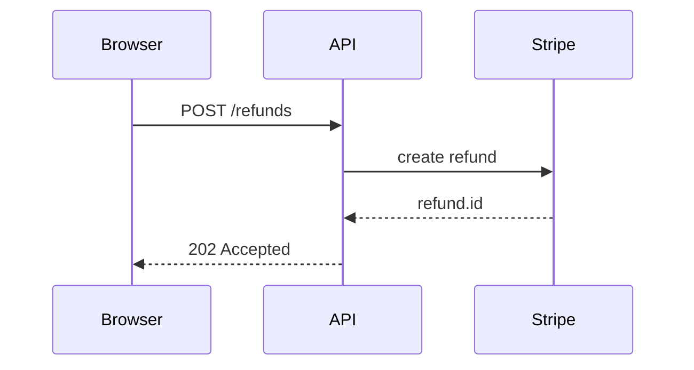

# show-me

Explain a change or a piece of code with the smallest picture that makes it click. Short prose, then a visual next to the sentence it supports. Default home for these visuals is the PR body.

## PR bodies

1. **First line:** one complete sentence saying what the PR does. It should make sense in a list of 50 other PRs.
2. **Why:** the problem and why this fix, in two or three sentences. Link the issue.
3. **Shape:** one or two visuals from the menu below, picked for what changed.
4. **How to verify:** exact commands, URLs, or clicks. Attach real proof (screenshot, test output) when you have it.

Use the repo's PR template if it has one, and slot the visuals into it.

## Pick the view

Match the view to the question the reviewer will ask:

| Reviewer asks | Show |
| --- | --- |
| "What does it do step by step?" | Pseudocode |
| "What calls what at runtime?" | Call tree |
| "Where does this sit in the UI?" | Component tree with the state that matters |
| "Which files own what?" | Shallow file tree with one-line roles |
| "Who talks to whom, in what order?" | Mermaid sequence diagram |
| "What exactly moved?" | Any of the above as a `diff` block |

Examples, kept tiny:

```text
fetchInvoice(id)
  cache.get(id)            # hit: return
  api.getInvoice(id)
    retry x3 on 5xx
  cache.set(id, ttl=60s)
```

```diff
 checkout/
 ├── cart.ts
-├── payment.ts
+├── payment/
+│   ├── stripe.ts        # card flow only
+│   └── refunds.ts       # moved out of cart.ts
 └── receipt.ts
```



Use a `diff` when the surrounding shape already exists and the point is the change. Paste the full block instead when the change is mostly additions, or when trimming would hide ordering or who owns what.

## Rules

- Every path, symbol, and arrow must exist in the real diff. Check before posting.
- One or two views. A collage of every format hides the point.
- Keep only the nodes the current question needs.
- Redact secrets, tokens, internal hostnames, and customer data.
- GitHub renders Mermaid in PR bodies and comments; prefer it over images that go stale.
- For layouts, visual UI states, or anything too dense for text, write one focused HTML file (a diagram or short slide) styled like the product, and attach or link it.

## Inspired by

- [HumanLayer, show-me](https://github.com/humanlayer/skills/tree/main/plugins/show-me) (MIT). Does well: a toolbox of tiny text visuals (pseudocode, call trees, component trees, file trees, Mermaid, diffs) and "pick the smallest view". Missing: nothing on PR descriptions, no rule that visuals must match the real diff, and no redaction guidance. Its [launch article](https://www.humanlayer.com/blog/show-me-skill) credits Dillon Mulroy and Matt Pocock as influences.
- [Google engineering practices, Writing good CL descriptions](https://github.com/google/eng-practices/blob/master/review/developer/cl-descriptions.md) (CC BY 3.0). Does well: a first line that stands alone, and a body that explains the problem and why this solution. Missing: text only, no visuals.
- [GitHub Docs, Creating diagrams](https://docs.github.com/en/get-started/writing-on-github/working-with-advanced-formatting/creating-diagrams). Does well: shows Mermaid and other diagram blocks render natively in Markdown. Missing: no advice on which diagram to draw.

## What this version adds

- A PR body structure (first line, why, shape, verify) built around the visuals.
- A "reviewer asks / show" table for choosing the view.
- Accuracy and redaction rules, plus new examples written for this repo.
