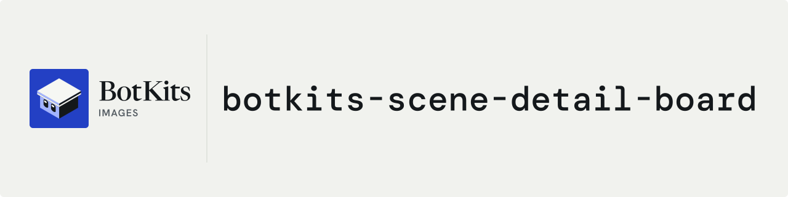

<picture><source media="(prefers-color-scheme: dark)" srcset="../../../assets/skills/header-botkits-scene-detail-board-dark.png 1x, ../../../assets/skills/header-botkits-scene-detail-board-dark@2x.png 2x"></picture>

# botkits-scene-detail-board

Turn one photo into a board: the photo on top, and a grid of small hand sketches of its details below.

Use this when you want a portrait image for a post, poster or product page that shows a scene, place, product or person and the small things that make it.

## Install

```sh
npx skills add botkitsdev/botkits --skill botkits-scene-detail-board
```

To list every skill in the repo: `npx skills add botkitsdev/botkits --list`.

No CLI? Copy this folder into the skills folder your agent uses, and keep `SKILL.md` inside it. Copy the skill folder itself, not the category folder.

## What it does

- Asks for the subject, the shape (4:5 by default), the tile count (6 by default) and the sketch look. It uses defaults for anything you leave out.
- Lists the details in the photo with a ladder: the whole subject, a surface, a part you can hold, the light, a sign of motion, a place marker, a small surprise. Each tile gets one detail that is really in the photo.
- Takes 3 or 4 colors from the photo. The sketches use only those colors, black ink and the paper tone.
- Plans the layout: photo on top, paper below with a short title, a rule, the tile grid, tile numbers and palette chips.
- Writes one plain-text image prompt from a template. If you give a photo, it keeps that photo unchanged.
- Checks the result against a list. If the model misspells the title, it adds the text in an HTML or SVG layer instead.

## Before / after (example)

### Before

You have a photo of a coffee cart on a street corner. A plain repost of the photo shows the scene, but not the small things that make it.

### After

The photo sits on top. Below it, on off-white paper, a short title sits over 6 ink-and-wash sketches: the cart, the wood counter, a cup, the morning light, steam, and the street sign shape. The sketches use 4 colors taken from the photo. You also get the filled prompt, the detail list and the palette.

## Use it in

- Used daily: Grok Bot.
- Installs with `npx skills add` (tested 18 Nov 2026): Claude Code, Codex, Cursor, Gemini CLI, GitHub Copilot and Grok Build.
- Supports the SKILL.md format (vendor docs): Claude apps (upload), ChatGPT (Business, Enterprise, Edu, Healthcare upload), and the other clients listed at [agentskills.io](https://agentskills.io/clients).
- Other agents that support the Agent Skills format can load it. We have not run it there.
- No direct install yet in ChatGPT dots or Meta Muse. Paste the instructions from [SKILL.md](SKILL.md) into a chat.

The agent needs access to an image model to make the board. Without one, it still writes the prompt.

| Agent | Put this folder here |
| --- | --- |
| Grok Bot | Paste [SKILL.md](SKILL.md) in a 1:1 chat and ask the Bot to save it as a skill. |
| Claude Code | `.claude/skills/botkits-scene-detail-board/` or `~/.claude/skills/botkits-scene-detail-board/` |
| Codex | `.agents/skills/botkits-scene-detail-board/` or `~/.agents/skills/botkits-scene-detail-board/` |
| Cursor | `.agents/skills/botkits-scene-detail-board/` or `.cursor/skills/botkits-scene-detail-board/` |
| Gemini CLI | `.gemini/skills/botkits-scene-detail-board/` or `.agents/skills/botkits-scene-detail-board/` (one folder deep only) |
| GitHub Copilot | `.github/skills/botkits-scene-detail-board/` or `.agents/skills/botkits-scene-detail-board/` |
| Grok Build | `.grok/skills/botkits-scene-detail-board/` or `~/.grok/skills/botkits-scene-detail-board/` |
| Claude apps | Turn on code execution. ZIP this folder and upload it in Customize, Skills. |

Install tested is not run tested.

## Links

- [botkits.dev](https://botkits.dev)
- Instructions: [SKILL.md](SKILL.md)

License: MIT
