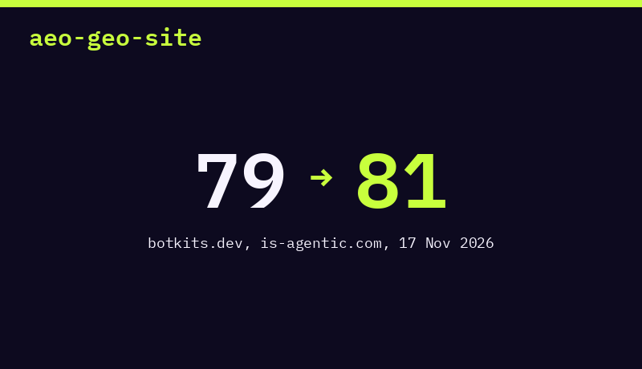

# botkits-aeo-geo-site

Make your site easy for ChatGPT, Gemini and Copilot to read, understand and cite.

Use this when shipping or restyling site pages meant to be found, understood, cited, or recommended by AI search, assistants, browsers, or agents.

## Install

```sh
npx skills add botkitsdev/botkits --skill botkits-aeo-geo-site
```

To list every skill in the repo: `npx skills add botkitsdev/botkits --list`.

No CLI? Copy this folder into the skills folder your agent uses, and keep `SKILL.md` inside it.

## What it does

- Treats SEO as the foundation (crawlable, fast, indexable pages), AEO as clarity (clear, structured, extractable answers), and GEO as trust (credible, consistent, justified facts).
- Covers three data planes when they apply: crawled web data; structured feeds and APIs (sitemaps, `llms.txt`, markdown twins, JSON-LD, public APIs); and the live website. The same HTML goes to bots and users. Extra formats are additive and must not carry different facts.
- Starts with server-rendered HTML, robots, sitemap, and canonicals. JSON-LD must match visible content. After a meaningful ship, rescan agent-readiness (for example is-agentic) and fix Essential misses before soft polish.
- Front-loads who the page is for, what problem it solves, what it is, and what it is not. Headings mirror real questions. One clear answer per section. Writes concrete claims, for example "ready in 20 minutes" or "works with your existing CI".
- Keeps the entity consistent: the same name, facts, and URLs across the site, profiles, and schema. Uses only real proof. No exaggerated claims, fake social proof, or a "#1" without a source.

## Before / after (example)

This example restyles a page so an assistant can read and cite it. The starting copy is built around keywords, and there is little an assistant can quote. Schema does not match what the page shows. There is no markdown twin or `llms.txt`. Soft claims sit in the first viewport.

Once restyled, the H1 and first viewport answer the reader's job. Visible facts match JSON-LD and any markdown twin. Headings are question-shaped where the intent is a question. The same facts are served to bots and users. After merge, you verify with a live fetch (HTML and markdown Accept) and an agent-readiness scan, then fix Essential misses first.



## Use it in

- Used daily: Grok Bot.
- Installs with `npx skills add` (tested 18 Nov 2026): Claude Code, Codex, Cursor, Gemini CLI, GitHub Copilot and Grok Build.
- Supports the SKILL.md format (vendor docs): Claude apps (upload), ChatGPT (Business, Enterprise, Edu, Healthcare upload), and the other clients listed at [agentskills.io](https://agentskills.io/clients).
- Other agents that support the Agent Skills format can load it. We have not run it there.
- No direct install yet in ChatGPT dots or Meta Muse. Paste the instructions from [SKILL.md](SKILL.md) into a chat.

| Agent | Put this folder here |
| --- | --- |
| Grok Bot | Paste [SKILL.md](SKILL.md) in a 1:1 chat and ask the Bot to save it as a skill. |
| Claude Code | `.claude/skills/botkits-aeo-geo-site/` or `~/.claude/skills/botkits-aeo-geo-site/` |
| Codex | `.agents/skills/botkits-aeo-geo-site/` or `~/.agents/skills/botkits-aeo-geo-site/` |
| Cursor | `.agents/skills/botkits-aeo-geo-site/` or `.cursor/skills/botkits-aeo-geo-site/` |
| Gemini CLI | `.gemini/skills/botkits-aeo-geo-site/` or `.agents/skills/botkits-aeo-geo-site/` (one folder deep only) |
| GitHub Copilot | `.github/skills/botkits-aeo-geo-site/` or `.agents/skills/botkits-aeo-geo-site/` |
| Claude apps | Turn on code execution. ZIP this folder and upload it in Customize, Skills. |

Install tested is not run tested.

## Premium

The free skill works by itself. The [AEO/GEO Site Audit & Build Kit](https://daniacostaai.gumroad.com/l/cxabi) adds tested code, templates and a worked example. Price: $9.

## Links

- [botkits.dev](https://botkits.dev)
- Instructions: [SKILL.md](SKILL.md)
- Inspired by: Microsoft Advertising's [AEO and GEO guide](https://about.ads.microsoft.com/content/dam/sites/msa-about/global/common/content-lib/pdf/from-discovery-to-influence-a-guide-to-aeo-and-geo.pdf) and [Alex Groberman's summary](https://www.linkedin.com/pulse/new-microsoft-just-revealed-how-get-traffic-from-alex-groberman-5af0c). Both are research material. This skill turns them into an execution checklist.

License: MIT
