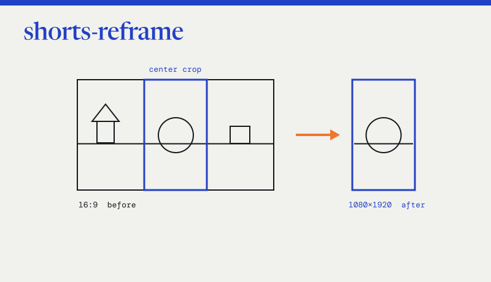

# shorts-reframe

Turn a 16:9 video into a 1080×1920 Short. Center crop, audio kept, length and resolution checked.

Use this when turning one landscape (16:9) clip into a vertical (9:16) clip with a fixed center crop.

## Install

```sh
npx skills add botkitsdev/botkits --skill shorts-reframe
```

To list the 31 skills in the repo: `npx skills add botkitsdev/botkits --list`.

No CLI? Copy this folder into the skills folder your agent uses, and keep `SKILL.md` inside it.

## What it does

- Crops the full height to a centered 9:16 slice, then scales to 1080×1920. The crop expression works at any 16:9 source size, including 1920×1080 and 1280×720.
- Copies the audio as-is with `-c:a copy`. If the source has no audio, drop that flag. Video is re-encoded because a crop changes the pixels.
- Stays on a fixed crop. It does not pan, zoom, or pad with letterboxing. If the subject sits off-center, set `x` explicitly, for example `crop=ih*9/16:ih:(iw-ih*9/16)/3:0`.
- After the encode, checks that the output is 1080×1920 and that its duration matches the source within a frame or two. If duration drifted, re-run and check you did not add `-t`, `-ss`, or a mismatched `-shortest` flag.

## Before / after (example)

This example starts with a 16:9 file, such as 1920×1080. The source is a full landscape frame. A default center crop keeps the middle and cuts the sides. If the subject sits off-center, that default window misses them.

Run this command:

```sh
ffmpeg -i input.mp4 -vf "crop=ih*9/16:ih,scale=1080:1920" -c:a copy output.mp4
```

ffprobe must then show width `1080`, height `1920`, and a duration that matches the source within a frame or two. If the subject was off-center, set `x` yourself instead of using the default.



## Works with

- Used daily: Grok Bot.
- Installs with `npx skills add` (tested 18 Nov 2026): Claude Code, Codex, Cursor, Gemini CLI, GitHub Copilot and Grok Build.
- It should work in any agent that supports the Agent Skills format. Install tested is not run tested.
- No direct install yet in ChatGPT dots or Meta Muse. Paste the instructions from [SKILL.md](SKILL.md) into a chat.

## Paid kits

[Shorts Builder Kit, $14](https://daniacostaai.gumroad.com/l/ommvol). It adds eased pan and zoom, a loudness check and a jitter check. The free skill works by itself.

## Links

- [botkits.dev](https://botkits.dev)
- Instructions: [SKILL.md](SKILL.md)
- Inspired by: [FFmpeg crop filter docs](https://ffmpeg.org/ffmpeg-filters.html#crop) and the [mediacodec.dev crop guide](https://mediacodec.dev/how-to/crop-video/). The docs are a filter reference and the guide has the centered crop. This skill adds the scale to 1080x1920 and the duration and resolution checks.

License: MIT
