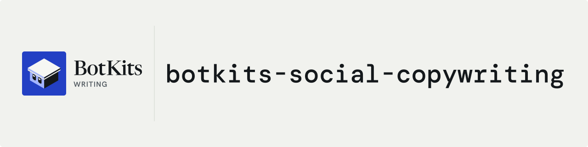

<picture><source media="(prefers-color-scheme: dark)" srcset="../../../assets/skills/header-botkits-social-copywriting-dark.png 1x, ../../../assets/skills/header-botkits-social-copywriting-dark@2x.png 2x"></picture>

# botkits-social-copywriting

Write posts that read native to X or LinkedIn. Use it once the idea exists; finish with botkits-no-ai-slop.

Use this when writing or adapting copy for X or LinkedIn so it matches the platform instead of sounding like a press release.

## Install

```sh
npx skills add botkitsdev/botkits --skill botkits-social-copywriting
```

To list every skill in the repo: `npx skills add botkitsdev/botkits --list`.

No CLI? Copy this folder into the skills folder your agent uses, and keep `SKILL.md` inside it.

## What it does

- Settles four things first: platform, format (single post, thread, or carousel text), the one takeaway, and the proof. No proof means the post is an opinion; write it as one.
- Finds the angle in the detail a press release would bury, then writes a hook that names a specific pain, result, image, or mechanism. If the first line is weak, it changes where the post starts.
- For X, writes for a reply, a quote, a send-by-DM, or a follow, using weights from xai-org/x-algorithm (read 14 Nov 2026). Line 1 names the concrete subject. The post stands alone if it has a link. A single post is one idea (280 characters without Premium). A thread is 5 to 12 posts. Use 0 to 2 hashtags, never mid-thread.
- For LinkedIn, the hook works before "see more" (about 140 characters on mobile). The body has no links and no hyphens. Up to four hashtags sit at the end. The middle includes one honest note.
- Both platforms: real units only, no invented figures, no engagement bait, no trailing period on the last line, and no em dashes. Delivers the post in a code block, then two lines: the angle and what was left out. When fixing a post, it critiques first, then rewrites. Posts about something you shipped go to botkits-ship-post.

## Before / after (example)

This example starts with an idea, or with a press-release draft. The first line restates the topic. The closer is a two-beat slogan or bait such as "Thoughts?". A link sits in a post that cannot stand without it, or LinkedIn copy is pasted onto X.

After the pass you get a native post in a code block, a hook that names a concrete subject, and an ending that is a result or a real question, plus a note on the angle. For LinkedIn, the hook fits before "see more", the link is in the comments, and hyphens are gone.

## Use it in

- Used daily: Grok Bot.
- Installs with `npx skills add` (tested 18 Nov 2026): Claude Code, Codex, Cursor, Gemini CLI, GitHub Copilot and Grok Build.
- Supports the SKILL.md format (vendor docs): Claude apps (upload), ChatGPT (Business, Enterprise, Edu, Healthcare upload), and the other clients listed at [agentskills.io](https://agentskills.io/clients).
- Other agents that support the Agent Skills format can load it. We have not run it there.
- No direct install yet in ChatGPT dots or Meta Muse. Paste the instructions from [SKILL.md](SKILL.md) into a chat.

| Agent | Put this folder here |
| --- | --- |
| Grok Bot | Paste [SKILL.md](SKILL.md) in a 1:1 chat and ask the Bot to save it as a skill. |
| Claude Code | `.claude/skills/botkits-social-copywriting/` or `~/.claude/skills/botkits-social-copywriting/` |
| Codex | `.agents/skills/botkits-social-copywriting/` or `~/.agents/skills/botkits-social-copywriting/` |
| Cursor | `.agents/skills/botkits-social-copywriting/` or `.cursor/skills/botkits-social-copywriting/` |
| Gemini CLI | `.gemini/skills/botkits-social-copywriting/` or `.agents/skills/botkits-social-copywriting/` (one folder deep only) |
| GitHub Copilot | `.github/skills/botkits-social-copywriting/` or `.agents/skills/botkits-social-copywriting/` |
| Grok Build | `.grok/skills/botkits-social-copywriting/` or `~/.grok/skills/botkits-social-copywriting/` |
| Claude apps | Turn on code execution. ZIP this folder and upload it in Customize, Skills. |

Install tested is not run tested.

## Links

- [botkits.dev](https://botkits.dev)
- Instructions: [SKILL.md](SKILL.md)
- Inspired by: [Jules Sauvajol's Copywriting-skill](https://github.com/judicael-s/Copywriting-skill/blob/8282f17e1f15d0f2b4fa19a90b2005864f77cbe5/skills/social-copywriting/SKILL.md) (MIT), [xai-org/x-algorithm](https://github.com/xai-org/x-algorithm) (Apache 2.0, read 14 Nov 2026), reporting on links in July 2026 from [PPC Land](https://ppc.land/x-drops-year-old-link-penalty-musk-tells-zuckerberg-on-platform/), [Repli](https://repli.sh/blog/do-links-hurt-reach-on-x/), and [Nieman Lab](https://www.niemanlab.org/2026/04/do-links-hurt-news-publishers-on-twitter-our-analysis-suggests-yes/), the [X heavy ranker README](https://github.com/twitter/the-algorithm-ml/blob/main/projects/home/recap/README.md), and [LinkedIn Engineering on feed dwell time](https://www.linkedin.com/blog/engineering/feed/understanding-feed-dwell-time). This skill adds ranking advice tied to X's published 2026 code, a link rule to test rather than assume a penalty, closer and reply rules, a hand-off to botkits-ship-post, LinkedIn house rules, and code-block delivery.

License: MIT
