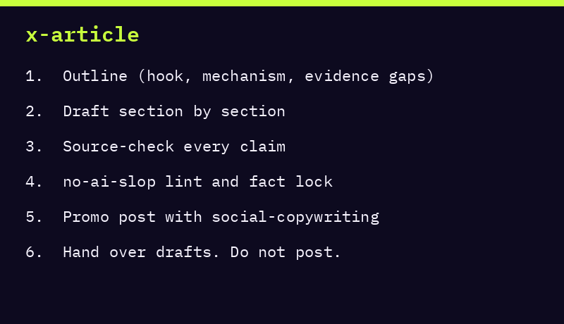

<picture><source media="(prefers-color-scheme: dark)" srcset="../../../assets/skills/header-botkits-x-article-dark.png 1x, ../../../assets/skills/header-botkits-x-article-dark@2x.png 2x"></picture>

# botkits-x-article

Turn rough notes into an X Article, with a first-line hook, images between sections and no invented numbers.

Use this for long-form X Articles on x.com/i/articles or compose/articles, not for tweets or numbered threads.

## Install

```sh
npx skills add botkitsdev/botkits --skill botkits-x-article
```

To list every skill in the repo: `npx skills add botkitsdev/botkits --list`.

No CLI? Copy this folder into the skills folder your agent uses, and keep `SKILL.md` inside it.

## What it does

- Uses a short, concrete title. The first line of the body is the hook. The title and the first line say different things. If the hook is weak, change the entry point before polishing.
- Builds the research body as question, then what you looked at, then what you could measure, then what you could not. Images sit between sections and explain the next paragraph. The cover is type-only, with no product mascot on a founder or research piece. The closer is one usable line, either a step the reader can take or a question you want answered. Hashtags only at the end, 0 to 2, and `#buildinpublic` only when the piece is actually build-in-public.
- No invented token counts, dollar figures, or quotes. Named instruments only (disk, chat volume, subagents, ad spend, HTTP bytes, git blobs). Source-check every claim. Unverified numbers come out.
- The pipeline is botkits-outline, botkits-draft section by section, botkits-source-check, botkits-no-ai-slop in Embedded mode plus its lint and fact-lock check, then a promo post written with botkits-social-copywriting. Both drafts go to whoever holds the account. The skill does not post.
- The Article is first person, specific, with short sentences mixed with longer ones. No press-release tone, and no unrelated product-promo CTA on a founder or research Article.

## Before / after (example)

This example starts with rough notes and a chart sitting in a pile at the end, plus a slogan planned for the closer. The notes are not yet an X Article. Figures are still unchecked. The title and the opening line repeat each other.

After the pipeline you have a short concrete title, a first-line hook that says something different, a body that runs question then evidence then gaps, images between the sections they explain, unverified numbers removed, a closer that is a step or a question, and a promo post. Both drafts are handed over. Nothing is posted.



## Use it in

- Used daily: Grok Bot.
- Installs with `npx skills add` (tested 18 Nov 2026): Claude Code, Codex, Cursor, Gemini CLI, GitHub Copilot and Grok Build.
- Supports the SKILL.md format (vendor docs): Claude apps (upload), ChatGPT (Business, Enterprise, Edu, Healthcare upload), and the other clients listed at [agentskills.io](https://agentskills.io/clients).
- Other agents that support the Agent Skills format can load it. We have not run it there.
- No direct install yet in ChatGPT dots or Meta Muse. Paste the instructions from [SKILL.md](SKILL.md) into a chat.

| Agent | Put this folder here |
| --- | --- |
| Grok Bot | Paste [SKILL.md](SKILL.md) in a 1:1 chat and ask the Bot to save it as a skill. |
| Claude Code | `.claude/skills/botkits-x-article/` or `~/.claude/skills/botkits-x-article/` |
| Codex | `.agents/skills/botkits-x-article/` or `~/.agents/skills/botkits-x-article/` |
| Cursor | `.agents/skills/botkits-x-article/` or `.cursor/skills/botkits-x-article/` |
| Gemini CLI | `.gemini/skills/botkits-x-article/` or `.agents/skills/botkits-x-article/` (one folder deep only) |
| GitHub Copilot | `.github/skills/botkits-x-article/` or `.agents/skills/botkits-x-article/` |
| Grok Build | `.grok/skills/botkits-x-article/` or `~/.grok/skills/botkits-x-article/` |
| Claude apps | Turn on code execution. ZIP this folder and upload it in Customize, Skills. |

Install tested is not run tested.

## Premium

The free skill works by itself. The [X Article Writer](https://daniacostaai.gumroad.com/l/lzowtl) adds tested templates and a worked example. Price: $7.

## Links

- [botkits.dev](https://botkits.dev)
- Instructions: [SKILL.md](SKILL.md)
- Inspired by: Dani Acosta's own X Article workflow. It builds on this repo's botkits-outline, botkits-draft, botkits-source-check, botkits-no-ai-slop and botkits-social-copywriting skills.

License: MIT
